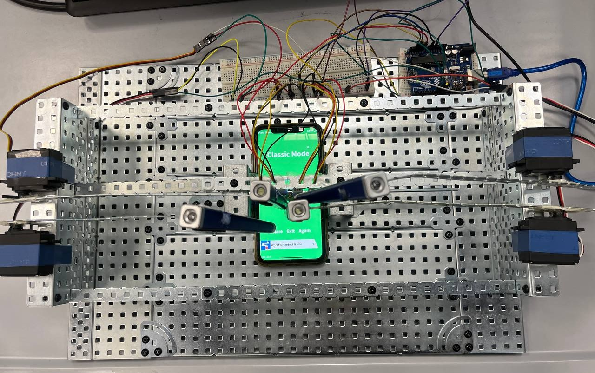

# Arduino-Based Automated Piano Tiles Robot

An automated robotic system built with Arduino Uno, photoresistors, and servo motors to play the mobile game *Piano Tiles* in real time.

## Overview
The robot detects incoming black tiles on a smartphone screen using four photoresistors. When a black tile passes beneath a sensor, the corresponding servo motor rotates a metallic arm fitted with a capacitive stylus to tap the screen and immediately returns to its resting position.

---

## Hardware Components
* **1x** Arduino Uno
* **1x** Breadboard & Jumper Wires
* **4x** Servo Motors
* **4x** Photoresistors (LDRs) + Pull-down Resistors
* **4x** Capacitive Stylus Pens
* **4x** Metallic Extension Arms (weighted to ensure sufficient screen tap pressure)
* **1x** Metallic Chassis/Frame

---

## Pinout & Wiring

| Lane / Channel | Photoresistor Pin | Servo Motor Pin | Notes |
| :--- | :--- | :--- | :--- |
| **Lane 0** | `A1` | `D11` | Swapped with Lane 1 due to physical stylus layout |
| **Lane 1** | `A0` | `D10` | Swapped with Lane 0 due to physical stylus layout |
| **Lane 2** | `A2` | `D9` | — |
| **Lane 3** | `A3` | `D8` | — |

---

## Schematic Layout

1. **Servo Motors** (2 mounted on the left, 2 on the right to prevent crowding)
2. **Metallic Sticks & Stylus Pens**
3. **4 Photoresistors** positioned over the 4 game lanes
4. **Smartphone** running *Piano Tiles* (Classic Mode)
5. **Arduino Uno**

---

## How It Works
1. **Color Detection:** Each photoresistor continuously reads ambient light reflected from its designated lane on the phone screen.
2. **Threshold Trigger:** When a dark/black tile passes under the sensor, the analog reading exceeds the calibrated threshold (`> 400`).
3. **Actuation:** The Arduino commands the corresponding servo to rotate from `0°` to `35°` for `7 ms` to tap the screen, then resets to `0°` with a `13 ms` recovery delay.

---

## Repository Contents
* `src/piano_tiles_robot/` — Main Arduino sketch for automated gameplay.
* `src/calibration_test/` — Serial monitor diagnostic sketch for calibrating photoresistor thresholds under different screen brightness levels.
